# Federated Meta-Learning on Edge Devices for Person Detection

## Summary

I implemented **First-Order Model-Agnostic Meta-Learning (FOMAML)** for **federated meta-learning** on edge devices, for person detection across varying environments. The system was deployed on both the resource-rich **Google Coral Dev Board Micro** and the resource-constrained **Arduino Nano 33 BLE Sense**.

A **frozen MobileNetV1** backbone, adapted for person detection through transfer learning and converted to TFLite, is used as a **feature extractor**. It produces a **256-dimensional embedding** that feeds a **fully-connected layer implemented in C++** on the edge devices. This layer was trained with the FOMAML procedure, using embeddings extracted from live camera images labelled through serial input (supervised learning).

To increase the diversity of meta-learning tasks, two additional **virtual devices** running the same model were simulated in Python. Each was trained on its own smartphone-captured dataset of myself and the background in a different environment: the **dining room** and the **garden**. The physical devices were trained live in two further, separate environments.

For every device I recorded **local accuracy and loss**, **per-round execution time**, and **SRAM/Flash usage**.
<!--

  

-->
## Results

### Client support and query accuracy

Each client (device) splits its local data into a **support set**, used for the inner-loop adaptation of the fully-connected layer, and a **query set**, used to evaluate the model. The query set is evaluated both **before** and **after** adaptation to show how much each client benefits from the meta-learned initialisation.

Each graph compares all four clients (dining room, garden, Coral Dev Board Micro, Arduino Nano 33 BLE Sense).

| Metric | Accuracy | Loss |
|:---:|:---:|:---:|
| **Support set** | 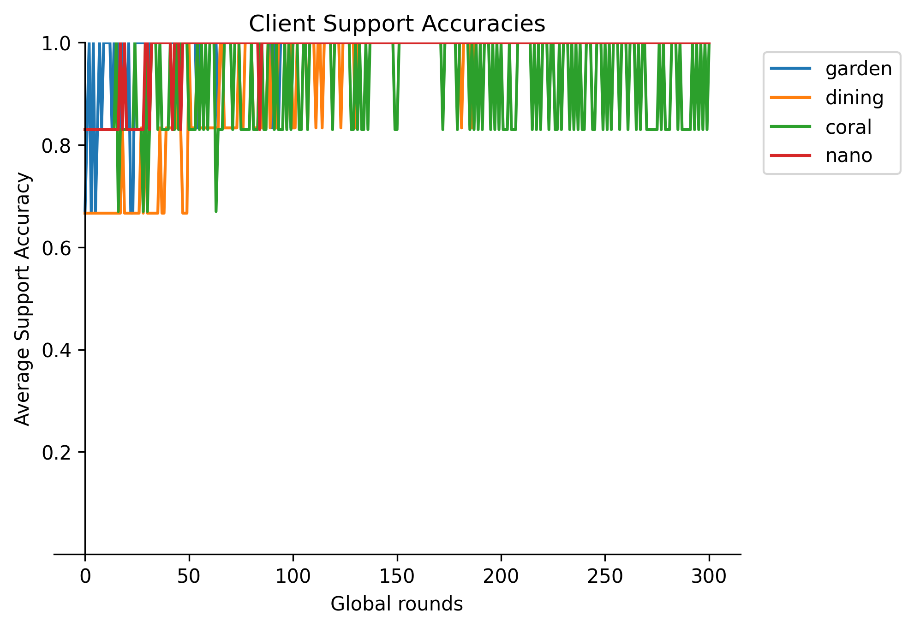 |  |
| **Query set (before adaptation)** | 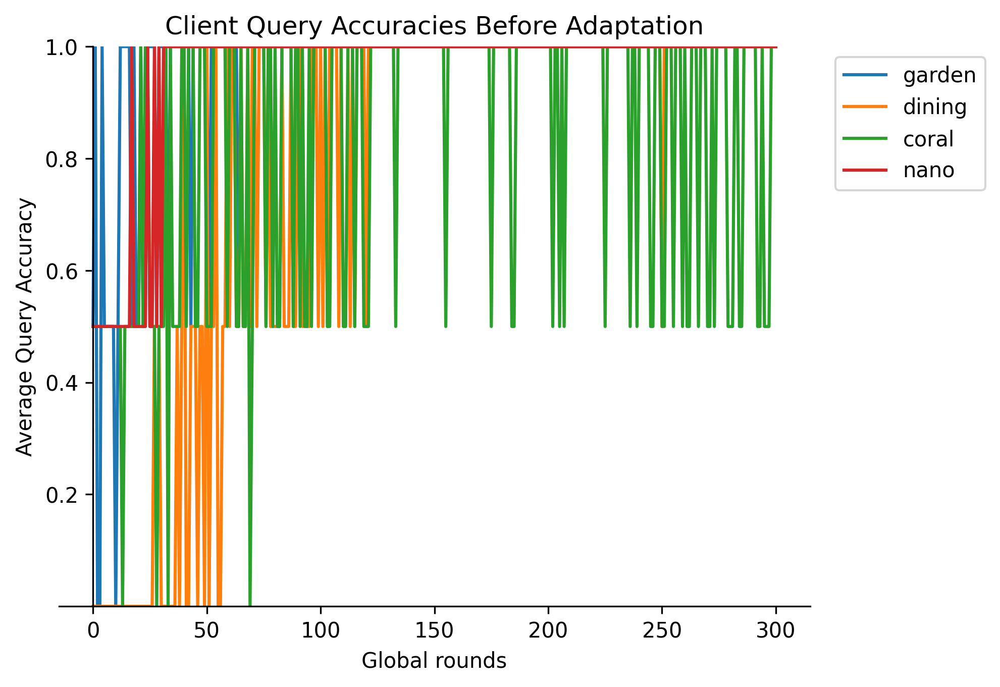 | 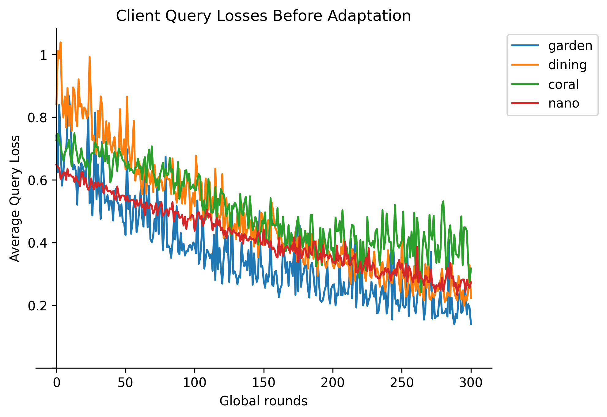 |
| **Query set (after adaptation)** | 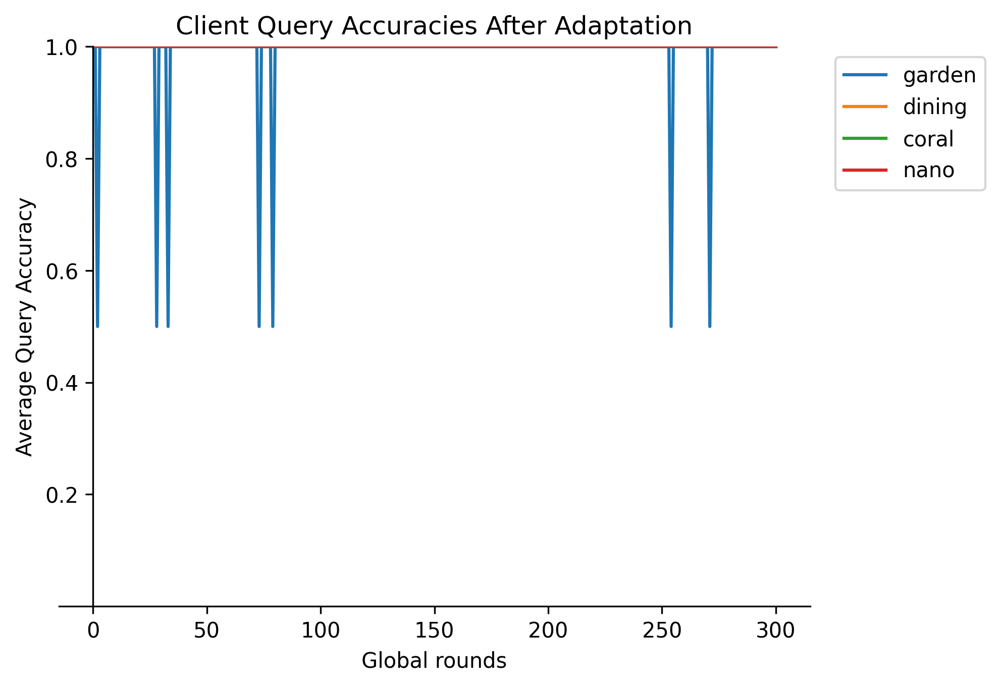 | 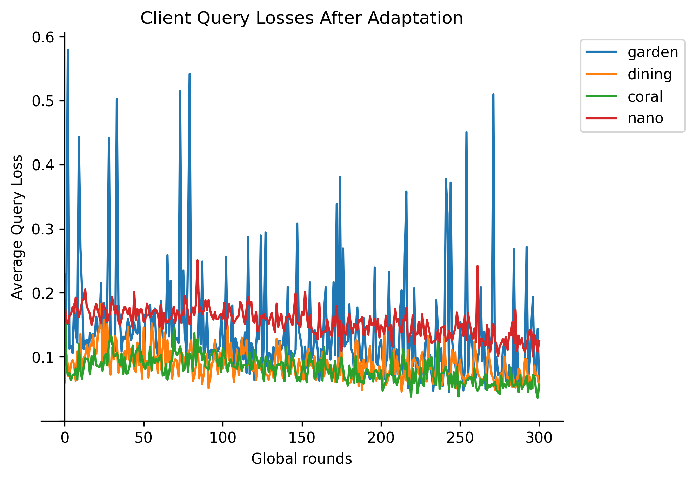 |

### Average local training time per round

| Client | Average training time (s) |
|---|---|
| Virtual Device – Garden | 0.0020030028 |
| Virtual Device – Dining room | 0.0020027224 |
| Coral Dev Board Micro | 0.8177057216 |
| Arduino Nano 33 BLE Sense | 0.8964878737 |

<em>The virtual devices run in Python on a PC, so their times are not directly comparable to the microcontrollers.</em>

### Memory usage

| Client | Flash | SRAM | SDRAM | Tensor arena |
|---|---|---|---|---|
| Arduino Nano 33 BLE Sense | 692.64 kB (70% of total) | 170 kB global/static (64% of total) | N/A | 112.6 kB (110 × 1024) in SRAM |
| Coral Dev Board Micro | 495.5 kB (0.37% of total) | 364.7 kB (47% of total) | 610 kB (2% of total) | 204.8 kB (200 × 1024) in SDRAM |

**Notes**
- **Arduino Nano 33 BLE Sense:** Flash includes the TFLite model, converted to a raw C array and stored in flash. SRAM includes the reserved tensor arena and the camera frame buffer.
- **Coral Dev Board Micro:** Flash includes the TFLite model, even though it is stored on a separate partition. SDRAM includes the reserved tensor arena and the camera frame buffer.

### Image comparison across devices

| Smartphone – Dining room (3000×4000) | Smartphone – Garden (3000×4000) | Coral Dev Board Micro (324×324) | Arduino Nano 33 BLE Sense (176×144) |
|:---:|:---:|:---:|:---:|
| 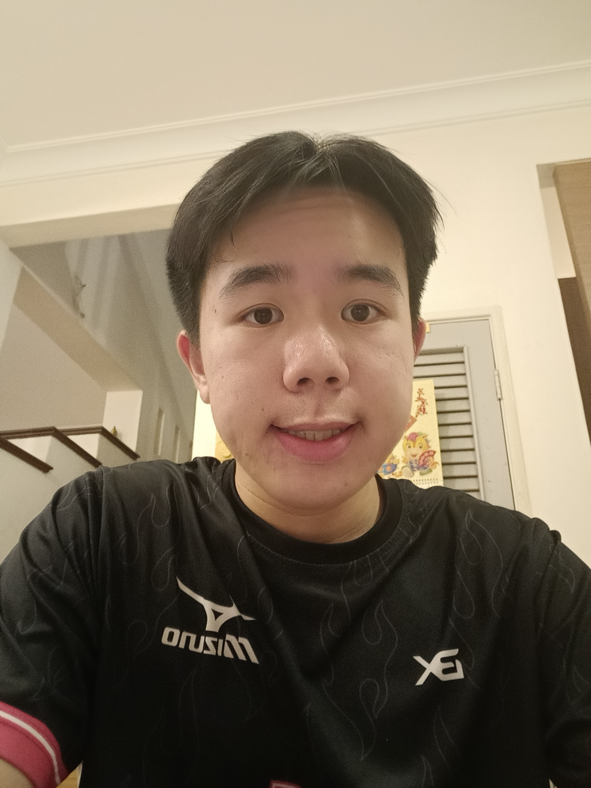 | 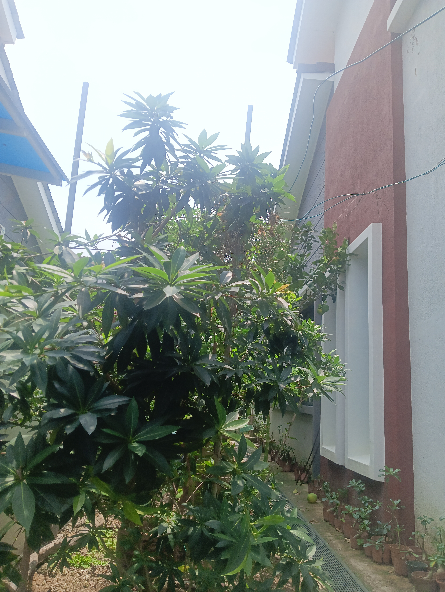 |  | 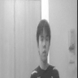 |
| 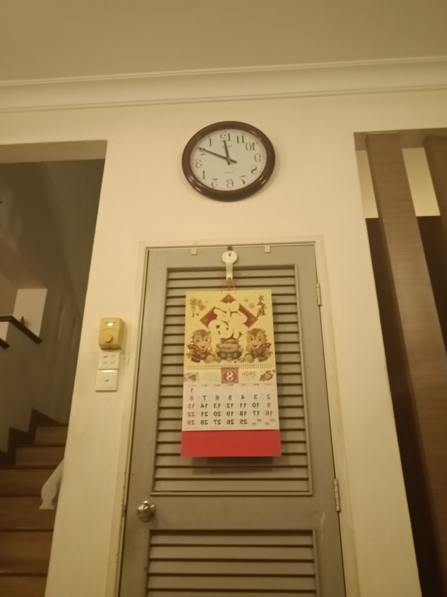 | 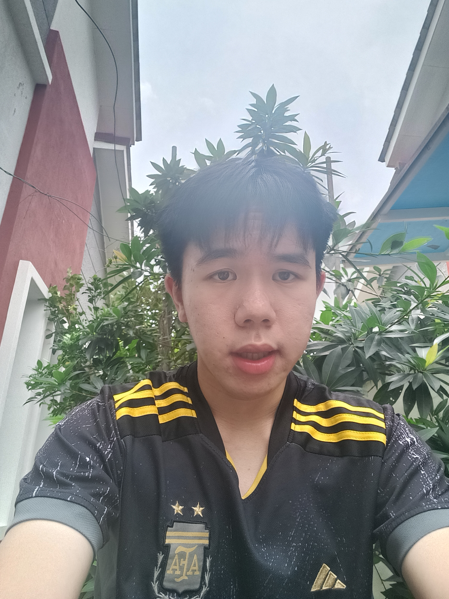 | 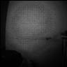 | 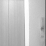 |

<em>Top row: person. Bottom row: background only. The Coral images are noticeably darker than the Arduino images despite the higher resolution.</em>

## Conclusion

The smartphone photos (3000×4000) had a much higher resolution than the images from the Coral Dev Board Micro (324×324) and the Arduino Nano 33 BLE Sense (176×144). Since downscaling to the model's 96×96 input keeps more detail from higher-resolution sources, the expected accuracy ranking was **virtual devices → Coral → Arduino**.

However, although the Coral and the Arduino operated under the same lighting conditions, the Coral's camera produced very dark images, making them less clear than the Arduino's despite their higher resolution. The observed ranking was therefore **virtual devices → Arduino → Coral**, showing that image quality can matter more than raw sensor resolution for on-device learning.

These results were used for further research into **federated adaptive meta-learning**, which adapts the input resolution of the TFLite model to devices with different resources.